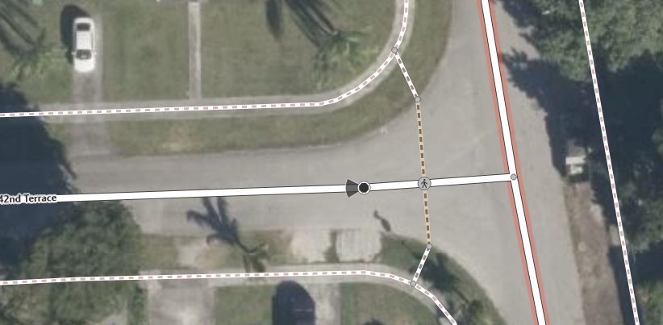

# Miami sidewalk additions #1

The goal here is to complete the [first pass for pedestrians](/my%20working%20definitions/Pass%20system/readme.md) throughout this area, this is only a first pass though. Below, [I](https://www.openstreetmap.org/user/Udarian) have described what tagging and geometry conventions I would like to see present by the end of this pass (by the time validation is complete), and what [I](https://www.openstreetmap.org/user/Udarian) feel can be left for the future, though if in your own contributions you'd like to add other tags, feel free, as they will eventually have to be added. There will be future passes to do (passes 2, 3 etc.), but those are for the future since it's better to have something rather than nothing, and adding values like `lit=*` can be done relatively easily once the ways are already separately mapped.

Below are my guidelines for how I would like the pedestrian features in the area to be mapped by the end of validation but if you are newer to mapping pedestrian features feel free to map to a lower level of detail, though I would challenge you to try and go to higher level of detail at least once as to improve as a mapper.

## Imagery sources to be used

At the beginning of the project it was recommended that "Bing Maps Aerial" be used as the main aerial imagery in this area, that has now changed. At the around beginning of 2026 "Esri World Imagery" updated, it is mostly the same as the 2025 imagery from the county. The "Bing Maps Aerial" is still a good source though so you can still check against it, just know that there has been construction between the bing and esri so the bing may be out of date. There is also an area that has really high tree cover where because the bing is lower resolution than the esri features under the trees are more likely to get lost in the noise on the bing making them harder to find in tat area so the esri is recommended in that area. A rough description of the this area with extremely high tree cover can be found in the following [geojson](/tasking%20manager/pedestrian%20feature%20addition%201/heavy%20tree%20cover.geojson) file, if you feel like its size/shape is incorrect and should be changed feel free to reach out and I will change its shape if need be. There is also new imagery from the County for 2026 but has to be loaded in iD as a custom source using the following source:

```text
https://imageserverintra.miamidade.gov/arcgis/rest/services/Woolpert2026/ImageServer/exportImage?f=image&bbox={bbox}&bboxSR={wkid}&imageSR={wkid}&size={width},{height}
```

For JOSM use the following GetCapabilities url:

```text
https://imageserverintra.miamidade.gov/arcgis/services/Woolpert2026/ImageServer/WMSServer?request=GetCapabilities&service=WMS
```

This new imagery from the county should be checked against in case any alignments are out of date due to construction between the 2025 and 2026 imagery to ensure alignments are correct. The "Bing Streetside" imagery is another good source of info along with the Mapillary Traffic Signs and Map Features, though ensure that you check the Mapillary Traffic Signs and Map Features against Bing Streetside if they seem at all fishy and or conflict with the already mapped features in the area as the Bing Streetside is newer generally (the Bing streetside is from the 2020's (mostly 2022 in this area) generally and the Mapillary is generally from 2015). 

## Footways:

As a general guideline try and map the geometry to [PWG the silver tier](https://wiki.openstreetmap.org/wiki/Foundation/Local_Chapters/United_States/Pedestrian_Working_Group/Schema). In essence this means that pedestrian features should be mapped as separate geometry.

### Sidewalks:

Below are the tags I would like to see on all sidewalks in this area by the end of this:

 - `highway=footway` + `footway=sidewalk`
 - `surface=*` (as a note, it’s usually “concrete” in this area) 

It would be preferable if sidewalk tagging on roads is not done as I find it significantly easier to add all of that at once and will once the project is complete.

As for geometry sidewalks (and more generally footways) should not touch road centerlines, so when a sidewalk goes directly up to a road, please split and add a `footway=link`, the exception here is `footway=crossing`.

### Crossings:

The following are the tags I would like to see for crossing ways:

 - `highway=footway` + `footway=crossing` 
 - `crossing=unmarked`, `uncontrolled`, and `traffic_signals`, please do not use `crossing=marked` or other variants.
 - `crossing:markings=*` (note, if there are markings, please try and find a value more specific than `yes`)
 - `surface=*` on way crossings, not the vertices (at least for now as that does not seem to be consensus at this point)

As for geometry, a crossing way (mapped separately) should only touch the sidewalk center line if the sidewalk doesn't not go completely around the block and ends at a road area with a crossing, in every other case there should be a sidewalk way (for now) connecting the centerline to the crossing. NOTE: please watch out for crossings that have markings but the crossing way cannot be mapped through the centerline of the crossing markings because of were the sidewalks connect on either side of the crossing, in those cases please just connect to the sidewalk as mentioned above.

crossings mapped as vertices should have the following tags:

 - `highway=crossing`
 - `crossing=*` (same guidance as for ways)
 - `crossing:markings=*` (same guidance as for ways)

When a sidewalk meets a road (including mapped driveways) there should be a `highway=crossing` with no `crossing=*` tag. Along those lines, when a sidewalk intersects with a service road, please do not split a crossing way out; the sidewalk should continue across as one way.

### Refuge islands:

Crossing islands should be mapped as separate geometry and tagged as follows:

 - `highway=footway` + `footway=traffic_island`
 - `surface=*`
NOTE: These should be mapped as geometry and not tagged on the crossing ways and vertices at all (`yes` or `no`).

### Access aisles:

The preferred tags here are as follows:

 - `highway=footway` + `footway=access_aisle`
 - `access_aisle:markings=*` (same as `crossing:markings=*` for values)
 - `surface=*`

As for geometry, the access aisle should only be mapped within the area that is marked, aka if the painted area does not go to the center line of the road, add a `footway=link` to connect from where the access aisle ends to the road centerline.

### General footpaths:

This really varies since there are quite a few cases where other `footway=*` values aren’t applicable but `highway=footway` is still warranted, I have included some examples where I have thoughts below. The first is the case were, at some road intersections there are sidewalk centerline's on either side of the road but on one or both of the sides of the road there is no sidewalk connecting to the road, here there should be a `highway=footway` + `informal=yes` way connecting to the road and a crossing between the two sides of the road. I have attached an image of the above below:



### Kerbs:

The following are the minimum tags I would like to see on any existing and newly added kerbs (as vertices), though I do not consider adding these as part of this task, so only add these if you feel that it's necessary (they will be added eventually):

 - `barrier=kerb`
 - `kerb=*` (please do not add kerb tags to crossings).
 - `tactile_paving=yes` or `no` (if it's `no`, still add the tag), please do not add tactile paving tags to crossings.

**Generally**, if a kerb vertex is not at the end of a way you likely need to split the crossing way. 

For any other tags, for any of the above, add at your own leisure unless I specifically mentioned not adding the tag.

One last Note here, if you initially mapped an area please refrain from validating areas you added so that we can have at least two pairs of eyes on any one area although if it eventually becomes obvious that this will not be possible feel free to do so, though only evaluate this request once the open tasks get close to complete. 

**Changeset comment**:#osmus-tasks-876 #Miami-Dade-projects Adding and updating pedestrian features in Miami Dade County (1)
